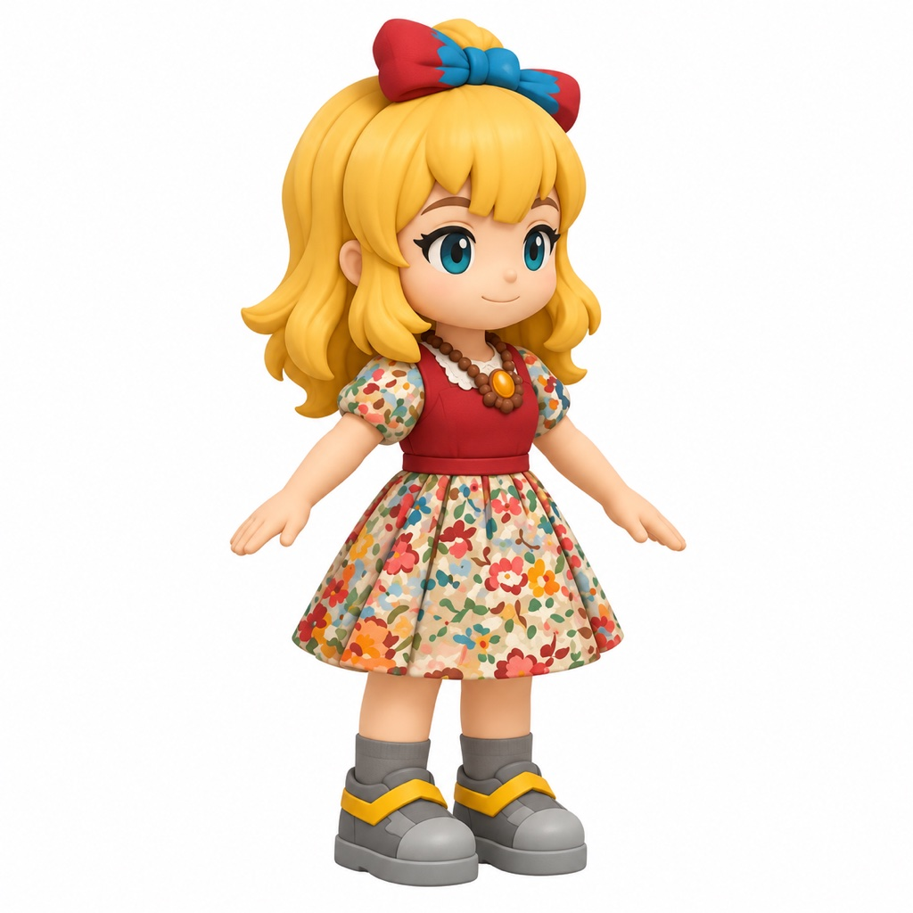
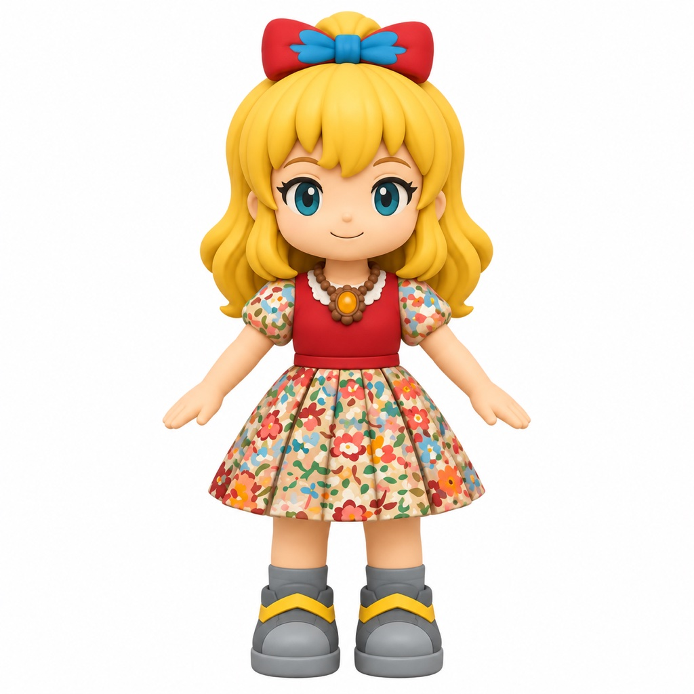
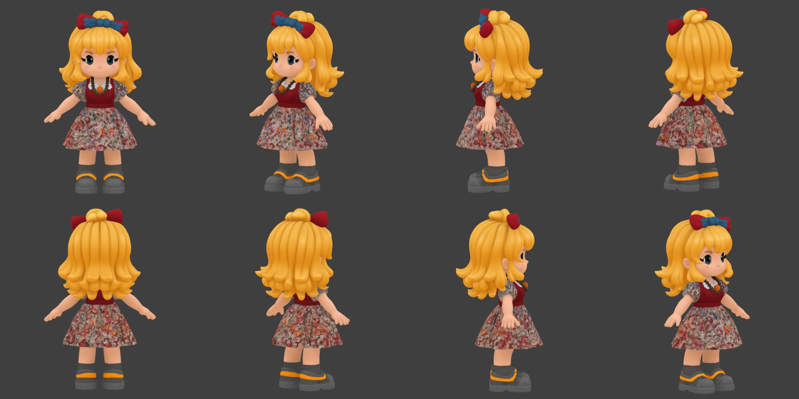
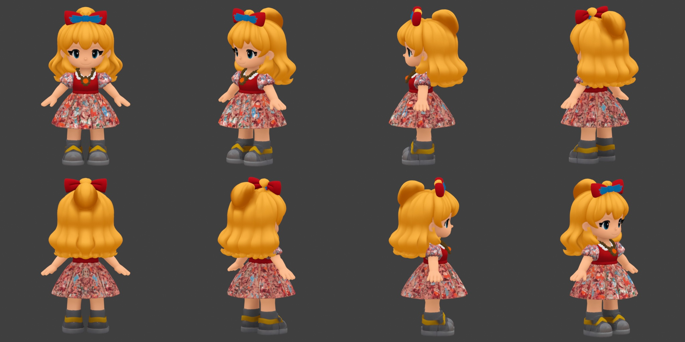
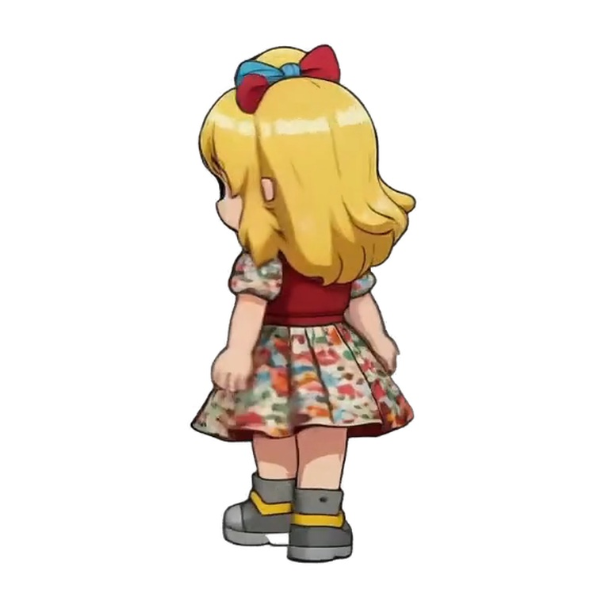
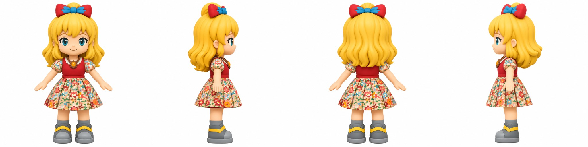
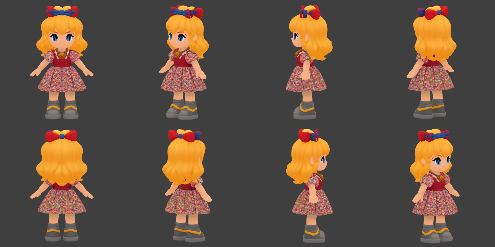
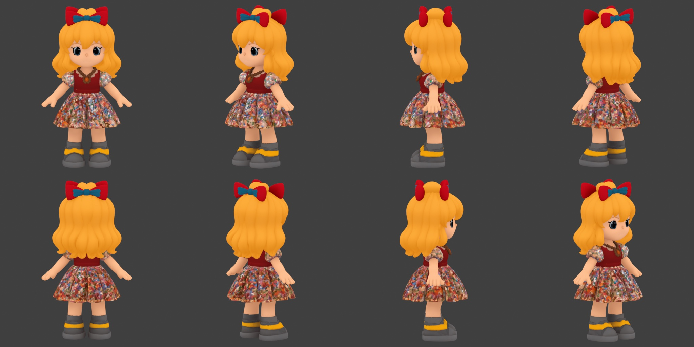
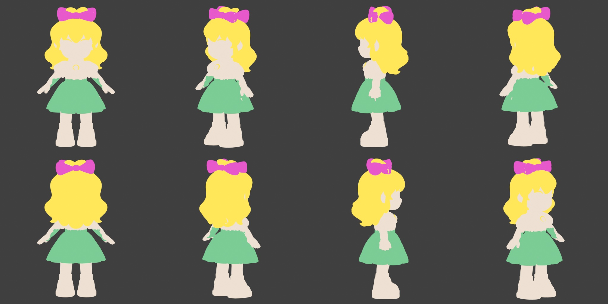

# Monet in 3D: what a feature-grade character costs with AI

Branch `feat/venelope`. Private self-study, no release plan.

## Question

A feature-animation lead character (the sprightly, kid-sized kind) is a body, a rig, hair
and cloth that move on their own, a face that acts, and a voice the face believes. Studios
spend many artist-years on one. **How much of that can current AI do, where does human
craft still carry it, and does what we learn become a repeatable Sprute pipeline?**

We answer it with **Monet**, our own character (`~/dev/monet`). The benchmark is the
*quality bar* of feature animation, not any studio's character: we study published craft
(talks, papers) for the bar and the methods, and build only Monet.

Why Monet works as the subject:

- **The design has the hard parts.** Long wavy hair with bangs, a big bow, puffed sleeves,
  a full pleated skirt, a pendant, chibi proportions (~1 : 2.5 head-to-body), squeezed-eye
  smiles and a big open mouth.
- **The canon is rich.** `contents/monet/` holds `monet-identity.webp` and ~65 clips (idle,
  walk, run, jump, dance, cry, talk, paint…). Each clip comes with `face.json`, `mouth.json`
  and `s3body3d.json` (per-frame 3D body keypoints), so we already have her own motion as
  data.
- **She already speaks.** Her daemon runs VAD → Whisper → Claude → ElevenLabs TTS, and the
  lip-sync and viseme specs live in `docs/superpowers/specs/2026-06-25-*`.
- **Identity is measurable.** Sprute's identity check scores renders against her canon.

## Axes

Each axis gets a ledger entry: **what AI did · what a human did · hours · would it repeat
for another character**.

| # | Axis | Monet specifics | Prior art | First experiment |
|---|------|-----------------|-----------|------------------|
| 1 | Mesh | chibi body, hair volume, skirt bell | Codex T-pose → TRELLIS.2 gave identity 0.93+ on stubby; single-view TRELLIS invented the head (`feat/3d-render`) | Codex draws Monet T-posed with the hair as separate masses → TRELLIS.2 on gin; split body / hair / skirt / bow |
| 2 | Body rig | short limbs, big head, so auto-rigs tuned for adult proportions may miss | `rig_mesh.py` nearest-surface weight transfer | auto-rig (Blender Rigify / an AI auto-rigger) vs transfer from a template; then deformation stress on her own poses |
| 3 | Secondary motion | hair locks, bangs, bow, sleeves, skirt, pendant | antenna spring (Materia Dangle port, `8ea31da`) | spring-bone chains for hair, bow and pendant first; cloth sim only for the skirt if springs can't hold the bell |
| 4 | Face | painted 2D face: closed-arc eyes, blush, mouth as a shape | mouth atlas, viseme spec | **decision**: 3D blendshapes vs a 2D texture face on the 3D head (anime-style). Prototype both on one expression set: neutral, happy, angry, sad, scared, shy |
| 5 | Voice → face | runtime lines, never scripted | ElevenLabs TTS + RMS mouth (v0) | drive visemes/blendshapes from the TTS audio; compare against her `talk-*` clips |
| 6 | Performance | she has to move like *her* | 65 clips with `s3body3d.json` | retarget her own clips onto the rig (mocap from her videos); measure identity and the eye test against the source clip |
| 7 | Look | painterly gouache with ink lines | Jin rejected painterly 3D and TRELLIS textures; projected paint kept the look (`paint_rig.py`) | toon shading + ink outline vs projected paint; render with Sprute's camera |
| 8 | Signature act | painting, flower magic | `paint-large`, `flower-magic` clips | one effect (brush strokes or flowers blooming) to test whether "her thing" survives in 3D |

## Order

Axes 1, 2 and 7 come first, because nothing else matters if the mesh and the look don't
read as Monet. Then 3 (cheap wins), 4 (the biggest design decision), 6, 5, 8.

## Measures

- **Identity** against canon stills and the matching source clip (Sprute's check).
- **Jin's eye test**: does it feel like her, on a 1–5 scale with one sentence on why.
- **Human-hours ledger** per axis, with the AI-vs-human split.
- **Repeatability**: rerun the finished steps on a second character (a Sprute example) and
  count what broke.

## Non-goals

No replicas of existing studio characters. No real-time engine export yet. No release.

## Compute

Mesh, sim bakes and renders run on gin through `gin-gpu run`. On the Mac, only previews.

## Ledger

### Axis 1: mesh, first pass (2026-11-03)

Codex drew Monet A-posed from `monet-idle-large.webp` + `monet-identity.webp`
(`tools/monet3d/apose-prompt.txt`), in a three-quarter view and a front view. Then
TRELLIS.2 textured (`trellis_shape.py --textured`, bf16) ran on gin. Renders come from
`tools/monet3d/turntable.py` (Blender, ortho, emission, so we see only the shape and the
baked colour).

| | three-quarter | front |
|---|---|---|
| drawing |  |  |
| mesh |  |  |
| TRELLIS time | 55 s | 80 s |
| vertices | 147k, one mesh | 156k, one mesh |

What held:
- **The front reads as Monet** in both: the bangs, the bow, the teal eyes, the pinafore,
  the necklace and pendant, and the shoes.
- **The A-pose worked.** Arms are clear of the skirt and hair, so the mesh is riggable.

What broke:
- **Unseen sides are invented.** The three-quarter mesh turns the back of her hair into
  sausage curls. The front mesh turns the half-ponytail into an off-centre bun on the back
  right. Neither matches canon, because canon never shows her back (the `back-walk` and
  `turns` clips do).
- **Fine pattern blurs.** The floral skirt bakes to a mottled red-brown; the colour
  survives, the flowers don't. The three-quarter bake is darker and duller.
- **It's one fused surface.** Hair, skirt, bow, sleeves and body are a single mesh, but
  axis 3 needs hair, skirt and bow as their own pieces.
- **The proportions drifted.** The head is about 1/3 of her height against canon's ~1/2.5,
  and that came from Codex's drawing, not from TRELLIS.

Split: AI did all of it (2 Codex calls, about 1 min each, + 2 TRELLIS runs). The human
part was the prompt and judging the result. That's minutes, not hours.

Next: give TRELLIS her back. Either a back-view drawing taken from her `back-walk` /
`turns` frames feeds a multi-view mesh, or the hair and skirt get remade as separate parts
(segment by baked colour, or draw each part alone) so they can carry physics. Then fix the
head ratio in the prompt.

### Axis 1: her back, second pass (2026-11-03)

Canon does show her back: `monet-turns.mp4` at 2.1 s (top half is colour, bottom half is
alpha), . It shows a half-ponytail at the crown with the
bow, and smooth waves to the shoulder blades. There's no bun and no curls.

Codex redrew the right, back and left views from the A-pose front plus that frame
(`tools/monet3d/turnaround-prompt.txt`):

Native TRELLIS.2 has no multi-view input, so `tools/monet3d/trellis_multi.py` conditions on
every view and chains the positives through `ConditioningCombine`. The sampler then
averages the per-view predictions, which is TRELLIS's multi-image "multidiffusion" idea in
stock ComfyUI nodes. One run, no new models.

| | 4 views (front, right, back, left) | 2 views (front, back) |
|---|---|---|
| mesh |  |  |
| TRELLIS time | 145 s | 100 s |

- **Her back is fixed** in both: smooth waves to the shoulder blades, the half-ponytail at
  the crown. The invented curls and bun are gone.
- **4 views wins.** Its face and eyes hold the canon teal-blue and the profiles are clean.
  With 2 views the side has no input, so the bow grows two red horns there and the eyes go
  dark.
- **The bow is still the weak part.** Even with 4 views, the bow seen from the side or
  back is a tangle of red and blue loops. The views disagree on its depth, and the average
  splits it. The bow should be its own part anyway (axis 3: it swings).
- **The skirt print** is still confetti, not flowers. That's TRELLIS's texture resolution,
  not the views. The fix belongs to axis 7 (projected paint or a tiling print texture), not
  to the mesh.
- **The head ratio** is still about 1/3, inherited from the drawing.

Split: AI did all of it (3 Codex calls + 1 TRELLIS run). The human part was finding the
canon back frame in her clips, which took minutes. That step needs an index: which clip and
frame shows which direction. Her `s3body3d.json` could give torso yaw per frame
automatically.

Next for axis 1: split the 4-view mesh into body, hair, skirt and bow (by baked colour and
connectivity), and remake the bow as a clean separate part.

### Axis 1: parts (2026-11-03)

`tools/monet3d/split_parts.py` cuts the 4-view mesh into body, hair, skirt and bow, all in
Blender with no ML:

- **Hair** = golden baked colour above the waist. **Bow** = red or blue above 0.86 of her
  height. Colour alone was enough for both.
- **The skirt can't be found by colour.** Its print has cream and pink flowers that read as
  skin, so a colour rule speckles it. Instead it's the height band from the hem to the
  waist, where the hem is found from the outline: the lowest slice whose width flares to
  the skirt's. Inside that band, only the hands (skin, far out, upper half) and the legs
  (inside the shell, near the hem) stay body.
- **A 12-round neighbour vote** over shared edges cleans the edges.
- Result: 88k body, 62k hair, 39k skirt and 10k bow faces. Edges are clean except a
  little sleeve speckle.
- It took 4 rounds of rules, each judged by eye on the part turntable. The thresholds are
  Monet's (waist 0.49, bow 0.86); a second character needs its own or a smarter detector.

**The cut parts are open shells.** Hair cut from the scalp leaves a hole in the head, and
the skirt leaves the legs and waist open underneath. That's fine for rendering. For
physics, the body under each part must be closed and the part needs thickness. That's the
start of axis 3.

GLBs: gin `~/sprute-3d/monet/` (`monet-mv4.glb` fused, `monet-parts.glb` split).
