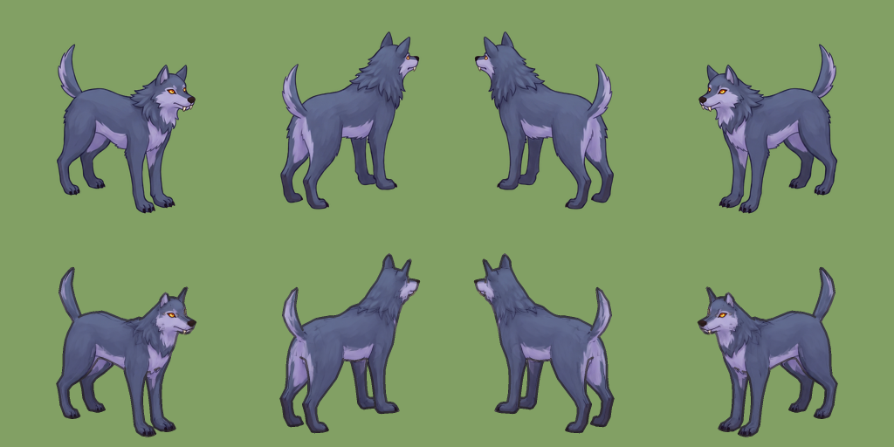

# Spike: build the character in 3D, render it to 2D sprites

2026-10-29, branch `claude/spike-3d-render-9a7d2e` (on top of PR #21, `claudia/monster-quadruped`).
Prototype: `tools/render3d/paint_rig.py`. Images: `docs/spikes/3d-render/`.

**Verdict: go, as a third animate backend (`--use render`) for monsters with a rig, not as a new pipeline.**
The riskiest assumption held on the first run: a design painted over a rig's pose, projected back onto the rig,
renders through every clip in Sprute's look, with no seed lottery. The first real step is in
[Recommendation](#recommendation).



## Problem

Sprute makes a character in 2D: generate (flux-fill) → AniSora turntable (directions strip) → SCAIL2 animates it,
driven by a GLB motion rendered on Template-kun (or, since PR #21, on the GLB's own body). Its weak spots are all
consequences of a video model drawing every frame:

- **Seed lottery.** Melting, ghost legs (the dusk wolf's gallop ghosted at seeds 11 and 12), facing flips (head
  turning, `TASKS.md`). `--attempts` and `sprute check` pay for retries; the check can't see ghost legs.
- **Body shape is bounded by the driver.** SCAIL2 follows a mesh render, so anything with a rig works, but the
  character must fit the driver's silhouette.
- **No exact direction consistency.** Each direction is drawn separately; a badge on the left shoulder can swap sides.

Materia meanwhile built a monster directly in 3D and baked it to 2D. Jin wants to know how Sprute would offer that
"made in 3D, shown as 2D" structure itself.

## What already exists

### Materia's stubby (PR 142, `feat/monster-3d`, merged)

| | |
|---|---|
| **Model** | Modelled **in code** (three.js primitives, lathes, rounded boxes in `packs/monsters/view/stubby.ts`), no generator. |
| **Rig / animation** | None. Procedural: bob, look around, a waddle driven by the speed it moves; antenna and strap tails are Verlet chains (`Dangle`), which the sibling session *Cloth & hair sim* generalises to chains and cloth in `packs/monsters/view/soft.ts`. |
| **Bake** | `npm run bake <id>` → `tools/bake/bake.ts` in headless Chrome. Orthographic camera, 15° pitch (Sprute's), light from the front that turns with the camera, toon ramp (3 tones) plus a stepped matcap for bare metal. Line art from silhouette (alpha), depth steps (3 cm), folds (normals > 60°) and material boundaries, drawn by distance so every line is the same width and anti-aliased. Rendered at 352, shrunk to 176, grown back to 256 to be "soft and low-res like the Sprute sheets". |
| **Output** | 8-row atlas, only rows 1/3/5/7 (diagonals) filled, 256 cells, 12 fps, idle 36 / walk 8 / run 8, WebP, `manifest.json` with `directions: 4`, anchor and figure height measured from the render. |
| **What broke** | Colours came out dark (linear render target read as sRGB; fixed in 7548fb3, Jin: "아직도 어두워" until then). Lines thick in one place and thin in another until they were drawn by distance. Light from the upper left didn't match the heroes. |
| **What Jin liked** | "이 방향 좋아", "훨 귀여워", the tin-can version: "지금 디자인 너무 좋아 … 메인에 머지하고 싶어". Wants anti-aliased outlines, not pixel art, so it matches Sprute characters. Recolour (band, eye) parked in TASKS as a paint-mask idea. |

Lesson for Sprute: the look is the hard part, not the plumbing, and Jin already approved one answer to it
(front light, even AA ink, soft downscale). The modelling method (code) doesn't carry over: Sprute users bring an
image, not a three.js file.

### Sprute

| Piece | Where | What it gives a 3D path |
|---|---|---|
| Renderer | `custom_nodes/sprute/renderer.py` | Skins any GLB in PyTorch and rasterises it with ComfyUI's rasteriser. Same camera as every Sprute character (15°, ortho, 180.5 px/m). **This is the 3D path's renderer already** — the prototype only changes its shading. |
| Own-body rigs | PR #21: `--motion rig.glb [--clip X] [--own-body]`, `Model.fit`, `motion_file.own` | Loads non-humanoid rigs and their clips (Quaternius husky: Idle, Walk, Gallop, Attack, …). |
| Paint-over design | `experiments/monster-quadruped` (`rigpose.py`, `todirs.py`, `p-wolf.txt`) | NBP paints the monster over a 2x2 render of the rig's first Idle frame, so the design already stands in the rig's pose (IoU 0.91). **This is what makes projection possible.** |
| 4-direction layout | `layout.py`, `--directions 4`, `--cell` (feat/monster) | Strip format: 8 cells, S E N W transparent, 12 fps. |
| Check | `sprute check animation --directions 4` | Identity/facing/coverage/colour per direction. |
| Atlas | Materia `tools/pack-atlas.py`, `check-atlas.py` | Strip → atlas + manifest. |
| TRELLIS.2 | `feat/3d-asset`, memory `trellis2-props` | Image → textured mesh on gin, 273 s bf16. Texture "too smooth" and dark next to sprites; decimation shreds below ~5k faces. No rig. |
| MoCapAnything | `feat/mocap-anything-v2` | Video → clip on the husky rig. New clips for a rig. |
| Kimodo | `character-motion` | Text → humanoid clip. |
| `--use` backends | PR #24 (`--use seedance`) | Precedent for swapping SCAIL2 inside animate. |

(There is no `feat/3d` branch locally or on origin; `feat/3d-asset` is the 3D work.)

## Options

### Where a 3D path plugs into the CLI

| Option | For | Against |
|---|---|---|
| **A. `create character --use 3d`**, a whole new pipeline | One command | Duplicates generate/turntable/animate; the 2D steps it replaces are only *animate*. |
| **B. A separate `sprute render` command** | Clear that no model runs | A second way to make the same strip; `--attempts`, `--directions`, `--cell`, check and preview would need wiring twice. |
| **C. `animate --use render`**, a backend beside SCAIL2 and Seedance (recommended) | Same inputs (directions strip + `--motion rig.glb --clip X`), same output strip, same check and atlas. PR #24 set the pattern. | Only valid when the directions strip was painted over that rig — needs a guard (below). |

C plus one design step. The design has to be painted over the rig's pose, so the character is made from the rig,
not the other way round:

```
sprute create character --body husky.glb --prompt "dusk wolf…"   # renders the rig's pose sheet, paints over it (NBP / flux-fill)
sprute animate character --character dusk.directions.png --motion husky.glb --clip Walk --use render
```

`--use render` refuses a directions strip whose silhouettes don't match the rig's pose render (IoU < 0.85 in any
direction), because projection then paints the wrong parts. The dusk wolf's design is at 0.91–0.92.

### Image → mesh → rig → animate → render, and which tools

| Stage | Options | Pick |
|---|---|---|
| Mesh | (1) a **template rig's own mesh** (Quaternius CC0 animals, Template-kun); (2) TRELLIS.2 from the design; (3) Tripo/Meshy (paid, external); (4) modelled in code (Materia) | (1) now. (2) as the next step, when the silhouette must be the design's (see *What it loses*). |
| Rig | (1) the template's own; (2) **skin-weight transfer from the template** onto a TRELLIS mesh — it is generated from a design already standing in the template's pose, so nearest-surface transfer (Blender *Data Transfer*) needs no posing; (3) UniRig / Tripo auto-rig | (1) now, (2) next. Auto-riggers are for shapes no template fits. |
| Texture | (1) **projective paint from the design views in the reference pose** (prototype); (2) TRELLIS's own texture | (1). It carries the painted style and needs no UVs. TRELLIS textures are de-lit and smooth (measured 58–78 % luminance). |
| Animation | rig clips (Quaternius), MoCapAnything (video → clip), Kimodo (humanoids), procedural (Materia's waddle, slimes) | All already exist; nothing new. |
| Render | Sprute's renderer + the shading in `paint_rig.py`; Materia's bake (three.js, headless Chrome) | Sprute's renderer: Python, no browser, runs where ComfyUI runs, already shares the camera. Port Materia's fold/material lines into it later. |

### Keeping the look consistent with 2D-path characters

The prototype takes four choices from the Materia bake and Sprute's renderer:

1. **Paint, not shading.** The colour is the design's own painting, so it carries NBP's style and light the same
   way SCAIL2 output does. No relighting, so no "too dark" problem.
2. **Same camera.** `renderer.camera` and `PIXELS_PER_METRE` — feet and size land where SCAIL2's do (the 3D and 2D
   wolves overlap at IoU 0.93 in rest pose).
3. **Even, anti-aliased ink** on silhouette and depth steps, rendered at 3x and averaged down (Jin's ask for the
   stubby: AA outline, not pixel art).
4. **Soft**: the 3x supersample averages to 256. Materia's 176 → 256 round trip is one line to add if it reads
   too crisp next to SCAIL2.

## Prototype

**Riskiest assumption:** that a rigged mesh can wear a 2D design well enough to pass as the 2D path's character
in every frame. Plumbing (strip layout, check, atlas) was never the risk — Sprute already renders GLBs. The look
was: Jin rejected a painterly 3D render for the tin, TRELLIS textures for props, and only accepted the stubby after
the bake learned Sprute's look. If a generic rigged mesh can't look like the design, the rest of the design is moot.

**What ran:** `tools/render3d/paint_rig.py` on the husky rig (Quaternius CC0, from PR #21) and the dusk wolf's
NBP design (`experiments/monster-quadruped/design/dusk.directions.cut.png`), the same inputs that made the SCAIL2
dusk wolf. For every pixel the rasteriser covers, the surface point is looked up in the reference pose (Idle,
frame 0, the pose the design was painted over), projected into each of the four design views, and coloured from the
views that see it (depth-tested against that view, weighted by how squarely it faces it). The paint then rides the
skin through any clip. ~120 lines, CPU only, on the Mac.

```
python tools/render3d/paint_rig.py husky-b.glb dusk.directions.cut.png out --name dusk \
    --clip Idle:40 --clip Walk:12 --clip Gallop:6
```

### Results

CHECK_RESULTS

## Costs and timings

| | 2D path (SCAIL2) | 3D path (this prototype) |
|---|---|---|
| Per clip, 4 directions | ~80 s on the RTX PRO 6000 per seed; gallop took 3 seeds | 2.9 s a frame on a MacBook CPU (walk 12 frames 35 s, idle 40 frames 2 min). GPU would be well under a second. |
| Retries | `--attempts`, by eye for ghost legs | none: same input, same pixels |
| Design | 3 NBP paint-overs (~$0.4) + BiRefNet | same |
| Per new clip | a GPU run | a CPU render |
| 8 directions from a 4-view design | a second SCAIL2 run | free: S/E/N/W are painted from their neighbours (`--directions 8`) |
| Next step (TRELLIS mesh) | — | +273 s on gin once per character, + weight transfer (seconds, Blender) |

## What it unlocks

- **No seed lottery.** Gallop's ghost legs are gone by construction; so are melts and facing flips. `--attempts`
  and the check become a sanity test, not a filter.
- **Exact direction consistency.** One surface, one colour; a mark on the left flank stays on the left flank.
- **Any body with a rig.** Big monsters (`--cell 512`), six legs, tails — whatever a rig moves. Fast motions are
  as cheap as slow ones.
- **8 directions from 4 paintings**, and later any angle or zoom.
- **Cheap clips.** A new motion is a CPU render; the GPU is needed only for the design.
- **Recolour and parts for free** later (Materia's parked paint-mask idea): the paint is a function of the
  surface, so a mask is one more channel.

## What it loses

- **The silhouette is the mesh's.** The design's mane and fluff outside the husky's surface are dropped; the head
  and ears are the husky's shape (IoU 0.93 to the design, design-only 400 px per cell). This is the main cost and
  the reason the next step is a mesh from the design.
- **Painted light is baked in.** A leg that swings keeps the light it was painted with. Fine at 256 px; it would
  show on a slow turn of a large part.
- **Unseen surfaces are guessed** (paw soles, under the belly, the inside of a mouth): they take the nearest paint.
- **No hallucinated life.** SCAIL2 adds fur that moves, breathing, small expression; a render moves only what
  the rig moves. Secondary motion needs bones or Materia's Verlet chains (`soft.ts`) ported.
- **Needs a rig per body type.** Humanoids have Template-kun; animals have Quaternius; anything else needs a mesh
  and a rig made — the step SCAIL2 doesn't need.
- **Design is tied to the rig's pose.** A free-hand reference (BYO character) can't be projected; it has to go
  through the paint-over step.

## Recommendation

**Go**, scoped to non-humanoid and large monsters, where SCAIL2 is weakest and rigs exist; humanoid characters
stay on SCAIL2, which adds life a rig doesn't have.

First real step: **TRELLIS.2 mesh from the paint-over design + skin weights transferred from the template rig,
rendered by `paint_rig.py`.** It is the one thing that decides whether the silhouette can be the design's
instead of the template's, and it needs nothing new (TRELLIS.2 is on gin, Blender is on gin). Measure IoU to the
design (target ≥ 0.97 vs 0.93 now) and look at the gallop.

After that, productise as `animate --use render` (move the projection into a `Sprute Render Painted Rig` node in
`custom_nodes/sprute`, with the IoU guard), and `create character --body rig.glb` for the paint-over.

Not recommended: porting Materia's code-modelled bake into Sprute. It's the right tool for a game that models its
monsters by hand, but Sprute's users bring images.
